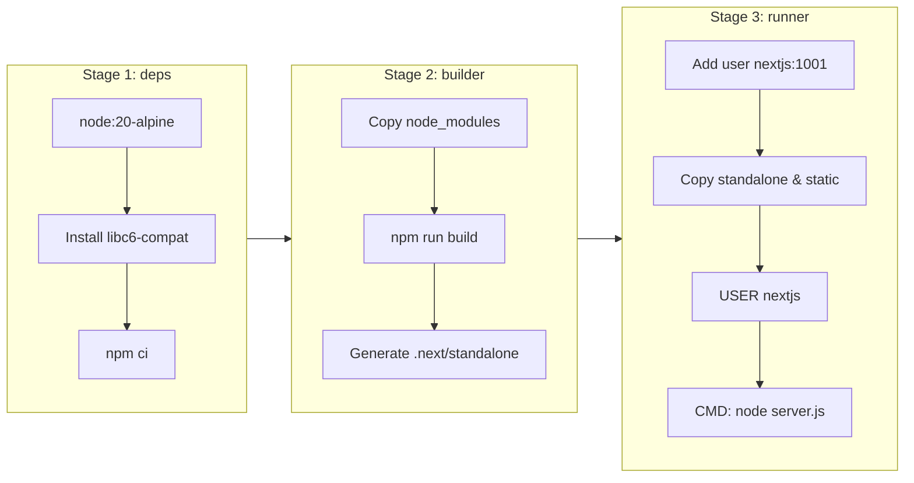

# FailoverApp — Multi-Cloud Disaster Recovery & Failover Engineering Guide

A comprehensive, production-grade guide to the **FailoverApp** architecture: an active-passive, multi-cloud disaster recovery system spanning **Microsoft Azure (Primary)** and **Amazon Web Services (Secondary)**, powered by a containerized **Next.js 14 App Router** service and **PostgreSQL**.

---

## Table of Contents

1. [Executive Summary & Failure Model](#1-executive-summary--failure-model)
2. [End-to-End System Execution Flow](#2-end-to-end-system-execution-flow)
   - [Phase 1: Normal Operation (Healthy Azure Primary)](#phase-1-normal-operation-healthy-azure-primary)
   - [Phase 2: Outage Detection & Automated Failover](#phase-2-outage-detection--automated-failover)
   - [Phase 3: Active Serving on AWS Secondary](#phase-3-active-serving-on-aws-secondary)
   - [Phase 4: Restoration & Failback](#phase-4-restoration--failback)
3. [Deep Infrastructure Specification](#3-deep-infrastructure-specification)
   - [AWS Infrastructure Stack (ap-southeast-2)](#aws-infrastructure-stack-ap-southeast-2)
   - [Azure Infrastructure Stack (eastus)](#azure-infrastructure-stack-eastus)
   - [Global Traffic Management & DNS Layer](#global-traffic-management--dns-layer)
4. [Software & Application Architecture](#4-software--application-architecture)
   - [Application Runtime & Server Lifecycle](#application-runtime--server-lifecycle)
   - [Data Layer, Connection Pooling & SSL](#data-layer-connection-pooling--ssl)
   - [Containerization & Multi-Stage Build](#containerization--multi-stage-build)
5. [CI/CD Automation Pipelines](#5-cicd-automation-pipelines)
   - [Workflow 1: AWS Continuous Deployment (`aws-deploy.yml`)](#workflow-1-aws-continuous-deployment-aws-deployyml)
   - [Workflow 2: Azure Continuous Deployment (`azure-deploy.yml`)](#workflow-2-azure-continuous-deployment-azure-deployyml)
   - [Workflow 3: Multi-Cloud Synchronized Release (`multi-cloud-release.yml`)](#workflow-3-multi-cloud-synchronized-release-multi-cloud-releaseyml)
   - [Workflow 4: Manual Disaster Recovery Drill (`failover-trigger.yml`)](#workflow-4-manual-disaster-recovery-drill-failover-triggeryml)
6. [Data Consistency & Replication Strategy](#6-data-consistency--replication-strategy)
7. [Operational Runbook & Verification Drills](#7-operational-runbook--verification-drills)
8. [Local Development Guide](#8-local-development-guide)
9. [Infrastructure State & Production Status](#9-infrastructure-state--production-status)

---

## 1. Executive Summary & Failure Model

### The Objective
To provide zero-downtime, continuous availability for a mission-critical web application even in the event of:
1. Complete primary cloud datacenter/region blackout (e.g., Azure `eastus` goes dark).
2. Compute infrastructure collapse (e.g., App Service crash loop or bad release).
3. Primary database failure or connection exhaustion.

### Architecture At A Glance

```
                         ┌────────────────────────┐
                         │   Global DNS Router    │
                         │ (Azure Traffic Manager │
                         │   or AWS Route 53)     │
                         └───────────┬────────────┘
                                     │
           ┌─────────────────────────┴─────────────────────────┐
           │ Priority 1 (Primary)                              │ Priority 2 (Standby)
           ▼                                                   ▼
┌─────────────────────────────────┐                 ┌─────────────────────────────────┐
│     Microsoft Azure (eastus)    │                 │    Amazon Web Services (Sydney) │
│                                 │                 │                                 │
│  ┌───────────────────────────┐  │                 │  ┌───────────────────────────┐  │
│  │     Azure App Service     │  │                 │  │ Application Load Balancer │  │
│  │   (Linux Container B1)    │  │                 │  │  (failover-app-alb:80)    │  │
│  └─────────────┬─────────────┘  │                 │  └─────────────┬─────────────┘  │
│                │                │                 │                │ TCP:3000       │
│                ▼                │                 │                ▼                │
│  ┌───────────────────────────┐  │                 │  ┌───────────────────────────┐  │
│  │ Azure Database PostgreSQL │  │                 │  │   ECS Fargate Container   │  │
│  │     (Flexible Server)     │  │                 │  │ (failover-service, 0.25c) │  │
│  └───────────────────────────┘  │                 │  └─────────────┬─────────────┘  │
│                                 │                 │                │ TCP:5432       │
│                                 │                 │                ▼                │
│                                 │                 │  ┌───────────────────────────┐  │
│                                 │                 │  │   Amazon RDS PostgreSQL   │  │
│                                 │                 │  │   (Postgres 16, Private)  │  │
│                                 │                 │  └───────────────────────────┘  │
└─────────────────────────────────┘                 └─────────────────────────────────┘
```

---

## 2. End-to-End System Execution Flow

### Complete Sequence Diagram

```mermaid
sequenceDiagram
    autonumber
    actor Client as User / Browser
    participant DNS as Traffic Manager / Route 53
    participant AzureApp as Azure App Service (eastus)
    participant AzureDB as Azure PostgreSQL
    participant AWSALB as AWS ALB (ap-southeast-2)
    participant AWSECS as AWS ECS Fargate
    participant AWSRDS as AWS RDS PostgreSQL

    Note over DNS,AzureApp: Phase 1: Normal Active Operation
    loop Every 10-30 seconds
        DNS->>AzureApp: GET /api/health (Health Probe)
        AzureApp->>AzureDB: SELECT 1
        AzureDB-->>AzureApp: OK
        AzureApp-->>DNS: HTTP 200 {"status":"ok","db":"ok"} (Healthy)
    end
    Client->>DNS: Resolve DNS for failover-app.com
    DNS-->>Client: Returns Azure App Service CNAME / IP
    Client->>AzureApp: GET / (Loads Web Dashboard)
    Client->>AzureApp: POST /api/messages (Writes message)
    AzureApp->>AzureDB: INSERT INTO messages (...)
    AzureDB-->>AzureApp: 201 Created
    AzureApp-->>Client: JSON Response

    Note over AzureApp,AzureDB: Phase 2: Failure Occurs (Azure DB or App crashes)
    AzureApp--xAzureDB: Database Unreachable / App Outage
    DNS->>AzureApp: GET /api/health
    AzureApp-->>DNS: HTTP 500 or Connection Timeout
    Note over DNS: Threshold exceeded (3 consecutive failures). Azure marked DEGRADED!

    Note over Client,AWSRDS: Phase 3: Failover to AWS Secondary
    Client->>DNS: Resolve DNS (TTL = 60s expires)
    DNS-->>Client: Returns AWS ALB DNS Name (ap-southeast-2)
    Client->>AWSALB: GET /
    AWSALB->>AWSECS: Forward request (port 3000)
    AWSECS->>AWSRDS: SELECT * FROM messages
    AWSRDS-->>AWSECS: Records returned
    AWSECS-->>AWSALB-->>Client: UI renders with "AWS" Orange Badge

    Note over AzureApp,DNS: Phase 4: Recovery & Failback
    AzureApp->>AzureDB: Connection restored
    DNS->>AzureApp: GET /api/health
    AzureApp-->>DNS: HTTP 200 OK
    Note over DNS: Azure marked ONLINE. Priority 1 resumes.
    Client->>DNS: Next query resolves back to Azure.
```

---

### Step-by-Step Flow Breakdown

#### Phase 1: Normal Operation (Healthy Azure Primary)
1. **DNS Query**: The user's browser issues a DNS resolution request for the domain (e.g., `app.domain.com`).
2. **Priority Evaluation**: Azure Traffic Manager or AWS Route 53 evaluates its routing table:
   - Endpoint 1 (Azure App Service): Priority `1`, Status: `ONLINE`.
   - Endpoint 2 (AWS ALB): Priority `2`, Status: `ONLINE` (Standby).
3. **Ingress**: DNS resolves to Azure. The browser initiates TLS/TCP handshake with Azure App Service.
4. **App Execution**: Node.js Next.js server processes the request, pulls a pooled connection from `pg.Pool`, writes or reads from Azure PostgreSQL Flexible Server, and returns the response.
5. **UI Detection**: The UI renders with a **Blue Badge: `Azure (eastus)`** reflecting `APP_ENV=azure`.

#### Phase 2: Outage Detection & Automated Failover
1. **Health Check Probing**: The global DNS service sends an HTTP `GET /api/health` request to both Azure and AWS every 10–30 seconds.
2. **Deep Health Check**: `/api/health` does **not** simply return a static string. It actively runs `SELECT 1` on PostgreSQL.
3. **Threshold Breach**: If Azure App Service crashes or Azure PostgreSQL stops answering:
   - Probe attempt 1 fails (timeout / 500).
   - Probe attempt 2 fails.
   - Probe attempt 3 fails (Tolerance threshold breached).
4. **Endpoint Demotion**: DNS Router marks Azure as `DEGRADED`.
5. **DNS Propagation**: Because Priority 1 is degraded, the DNS router immediately begins returning Priority 2 (AWS ALB) on all new DNS queries. Clients switch over as soon as their 60-second DNS TTL expires.

#### Phase 3: Active Serving on AWS Secondary
1. **Client Reroute**: All subsequent HTTP requests hit the AWS Application Load Balancer (`failover-app-alb`) in Sydney (`ap-southeast-2`).
2. **VPC Routing**:
   - The ALB terminates HTTP on port 80 and forwards traffic to private ECS Fargate tasks on target port 3000.
   - Security group `ecs-tasks-sg` allows traffic **only** from `alb-sg`.
3. **AWS Database Execution**: The Next.js container connects to Amazon RDS PostgreSQL 16 via the internal VPC network on port 5432.
4. **UI Detection**: The UI auto-refreshes every 10 seconds. The badge turns **Orange: `AWS (ap-southeast-2)`** reflecting `APP_ENV=aws`.

#### Phase 4: Restoration & Failback
1. Once Azure repairs its database or service, `/api/health` returns `200 OK`.
2. DNS router records consecutive successful probes and restores Azure to `ONLINE`.
3. Because Azure is configured as **Priority 1**, DNS routing resumes sending traffic to Azure.

---

## 3. Deep Infrastructure Specification

### AWS Infrastructure Stack (`ap-southeast-2`)

Managed via Infrastructure as Code in [`infra/aws/main.tf`](infra/aws/main.tf):

```
                        VPC (Default VPC: 172.31.0.0/16)
 ┌──────────────────────────────────────────────────────────────────────────┐
 │ Public Subnets (ap-southeast-2a, ap-southeast-2b, ap-southeast-2c)      │
 │                                                                          │
 │   ┌───────────────────────┐                                              │
 │   │  Internet Gateway     │                                              │
 │   └──────────┬────────────┘                                              │
 │              │                                                           │
 │              ▼                                                           │
 │   ┌───────────────────────┐     Security Group: failover-app-alb-sg      │
 │   │ Application Load      │     - Inbound: Port 80 (0.0.0.0/0)           │
 │   │ Balancer (ALB)        │     - Outbound: All                          │
 │   └──────────┬────────────┘                                              │
 │              │ Target Group: failover-app-tg (Port 3000, Target: IP)     │
 │              ▼                                                           │
 │   ┌───────────────────────┐     Security Group: failover-app-ecs-tasks-sg│
 │   │ ECS Fargate Tasks     │     - Inbound: Port 3000 (from ALB-SG only)  │
 │   │ (0.25 vCPU, 512MB RAM)│     - Outbound: All                          │
 │   └──────────┬────────────┘                                              │
 │              │ TCP: 5432                                                 │
 │              ▼                                                           │
 │   ┌───────────────────────┐     Security Group: failover-app-rds-sg      │
 │   │ Amazon RDS PostgreSQL │     - Inbound: Port 5432 (from ECS-SG only)  │
 │   │ (db.t4g.micro, 20GB)  │     - Publicly Accessible: FALSE (Secured)   │
 │   └───────────────────────┘                                              │
 └──────────────────────────────────────────────────────────────────────────┘
```

#### Detailed AWS Resource Breakdown

| Resource Type | Resource Name | Key Configuration Attributes |
| :--- | :--- | :--- |
| **VPC & Subnets** | Default VPC | Auto-discovered by Terraform data source across all Availability Zones in `ap-southeast-2`. |
| **Security Group (ALB)** | `failover-app-alb-sg` | Ingress: Port `80` (HTTP) from `0.0.0.0/0`. Egress: All. |
| **Security Group (ECS)** | `failover-app-ecs-tasks-sg`| Ingress: Port `3000` restricted strictly to `failover-app-alb-sg`. Egress: All. |
| **Security Group (RDS)** | `failover-app-rds-sg` | Ingress: Port `5432` restricted strictly to `failover-app-ecs-tasks-sg`. No public access. |
| **Application Load Balancer** | `failover-app-alb` | Public internet-facing ALB. Attached to subnets across all AZs. |
| **ALB Target Group** | `failover-app-tg` | Target Type: `ip`. Port: `3000`, Protocol: `HTTP`. Health Check: `/api/health`, interval `15s`, timeout `5s`, threshold `2`, code `200`. |
| **ECS Cluster** | `failover-cluster` | Managed ECS Container Cluster. |
| **ECS Task Definition** | `failover-app` | Fargate launch type. CPU: `256` (0.25 vCPU), Memory: `512` MB. Network Mode: `awsvpc`. Contains single container on port `3000`. |
| **ECS Service** | `failover-service` | Launch Type: `FARGATE`. Desired Count: `1`. Connected to `failover-app-tg`. Assigns public IP for outbound ECR pulls. |
| **Container Registry** | `failover-app` (ECR) | Scan on push: `true`. Mutability: `MUTABLE`. |
| **Relational Database** | `failover-app-pg` (RDS) | Engine: `postgres 16`. Class: `db.t4g.micro`. Storage: `20 GB gp3`. Subnet Group: default VPC subnets. `publicly_accessible = false`. |
| **Logging** | `/ecs/failover-app` | CloudWatch Log Group with 7-day retention. Stream prefix: `ecs`. |
| **IAM Execution Role** | `failover-app-ecsTaskExecutionRole` | Grants Fargate agent permission to pull from ECR and stream logs to CloudWatch. |
| **IAM Task Role** | `failover-app-ecsTaskRole` | Container application runtime role. |

---

### Azure Infrastructure Stack (`eastus`)

Managed via Infrastructure as Code in [`infra/azure/main.tf`](infra/azure/main.tf) and [`infra/azure/main.bicep`](infra/azure/main.bicep):

| Resource Type | Resource Name | Key Configuration Attributes |
| :--- | :--- | :--- |
| **Resource Group** | `failover-rg` | Location: `eastus`. |
| **App Service Plan** | `failover-app-plan` | OS: `Linux`. SKU: `B1` (Basic compute tier, 1 vCPU, 1.75 GB RAM). |
| **Web App** | `failover-app-<random>` | Linux Web App running Docker container. `always_on = true`. Health Check Path: `/api/health`. |
| **App Settings** | Environment Variables | `DATABASE_URL`, `APP_ENV=azure`, `REGION=eastus`, `NODE_ENV=production`. |
| **PostgreSQL Server** | `failover-app-pg-<random>` | Azure Database for PostgreSQL Flexible Server. Version `16`. SKU: `B_Standard_B1ms`. Storage: `32 GB`. |
| **Database** | `failoverdb` | UTF-8 collation database. |
| **Container Registry** | Azure Container Registry (ACR) | Hosts application Docker image. |

---

### Global Traffic Management & DNS Layer

Detailed in [`infra/dns/failover-setup.md`](infra/dns/failover-setup.md):
- **Routing Engine**: Azure Traffic Manager (or AWS Route 53 Traffic Flow).
- **Routing Algorithm**: **Priority Routing** (Active-Passive).
- **TTL**: `60 seconds` (balances cache efficiency against failover reaction time).
- **Health Probing Engine**:
  - Protocol: `HTTP`
  - Port: `80` (or `443` HTTPS with custom domain TLS)
  - Path: `/api/health`
  - Probe Interval: `10` to `30` seconds
  - Timeout: `5` to `10` seconds
  - Degraded Threshold: `3` failed probes

---

## 4. Software & Application Architecture

### Application Runtime & Server Lifecycle
- Built on **Next.js 14 App Router** (`app/layout.tsx`, `app/page.tsx`).
- Standalone output mode enabled in `next.config.js`:
  ```javascript
  module.exports = {
    output: 'standalone',
  };
  ```
  This creates an isolated, self-contained `server.js` file with minimal `node_modules` dependencies, reducing Docker image size to ~150MB.

### Data Layer, Connection Pooling & SSL ([lib/db.ts](lib/db.ts))

```typescript
import { Pool, PoolConfig } from 'pg';

let dbUrl = process.env.DATABASE_URL || '';
const requiresSsl = dbUrl.includes('sslmode=require') || 
  (process.env.NODE_ENV === 'production' && !dbUrl.includes('localhost') && !dbUrl.includes('@db:'));

// Strip query string params to prevent driver collisions
if (dbUrl.includes('?')) {
  dbUrl = dbUrl.split('?')[0];
}

const poolConfig: PoolConfig = {
  connectionString: dbUrl,
  ...(requiresSsl ? { ssl: { rejectUnauthorized: false } } : {}),
};

const pool = new Pool(poolConfig);
```

#### Key Reliability Patterns:
1. **Adaptive SSL**: Bypasses SSL on local Docker networks (`@db:5432`) while enforcing TLS encryption on AWS RDS and Azure Flexible PostgreSQL.
2. **Table Initialization Memoization**:
   ```typescript
   let initPromise: Promise<void> | null = null;
   export async function initDb(): Promise<void> {
     if (!initPromise) {
       initPromise = query(`CREATE TABLE IF NOT EXISTS messages (...)`)
         .catch(err => { initPromise = null; throw err; });
     }
     return initPromise;
   }
   ```
   Ensures `CREATE TABLE IF NOT EXISTS` executes **exactly once per container lifecycle**, eliminating database catalog locking on high-frequency API calls.

### Containerization & Multi-Stage Build ([Dockerfile](Dockerfile))



- **Security Compliance**: Uses non-root user `nextjs` (UID 1001), preventing container breakout exploits.
- **Minimal Surface**: DevDependencies and package managers are stripped from the final runtime container.

---

## 5. CI/CD Automation Pipelines

Four integrated GitHub Actions workflows automate building, testing, deploying, and failing over:

### Workflow 1: AWS Continuous Deployment (`aws-deploy.yml`)
- **Trigger**: Automatic on `push` to `main`, or manual `workflow_dispatch`.
- **Pipeline Stages**:
  ```
  [Test & Lint] ──> [AWS Auth] ──> [Docker Buildx] ──> [Push ECR] ──> [ECS Force Deploy] ──> [Health Verification Loop]
  ```
- **Automated Verification Loop**: The pipeline executes an active polling loop against the ALB:
  ```bash
  for i in {1..12}; do
    STATUS=$(curl -s -o /dev/null -w "%{http_code}" "$HEALTH_URL")
    if [ "$STATUS" = "200" ]; then break; fi
    sleep 10
  done
  ```

### Workflow 2: Azure Continuous Deployment (`azure-deploy.yml`)
- **Trigger**: Manual `workflow_dispatch` (promotes images to Azure Primary).
- **Pipeline Stages**:
  - Tests & Linting.
  - Builds and tags image for Azure Container Registry (ACR).
  - Deploys container image to Azure Linux Web App via `azure/webapps-deploy@v3`.
  - Verifies `/api/health` on Azure endpoint.

### Workflow 3: Multi-Cloud Synchronized Release (`multi-cloud-release.yml`)
- **Trigger**: `workflow_dispatch` with input choices: `both`, `azure-only`, or `aws-only`.
- **Parallel Deployment**: Runs `deploy-azure` and `deploy-aws` concurrently after passing shared tests.
- **Unified Markdown Matrix**: Renders a deployment comparison table in GitHub Step Summary.

### Workflow 4: Manual Disaster Recovery Drill (`failover-trigger.yml`)
- **Trigger**: Manual `workflow_dispatch`.
- **Inputs**: `action` (`failover-to-aws` or `failback-to-azure`).
- **Execution**: Invokes Azure CLI:
  ```bash
  az network traffic-manager endpoint update \
    --resource-group "$AZURE_RESOURCE_GROUP" \
    --profile-name "$TM_PROFILE_NAME" \
    --name azure-primary \
    --type azureEndpoints \
    --endpoint-status Disabled
  ```
  Immediately forces all DNS traffic to AWS, and probes the AWS endpoint to verify that failover succeeded.

---

## 6. Data Consistency & Replication Strategy

In an active-passive multi-cloud architecture, keeping data consistent across clouds without high latency is a primary architectural consideration.

### Production Synchronization Strategies

| Strategy | Architecture | Latency | Complexity | Best For |
| :--- | :--- | :--- | :--- | :--- |
| **PostgreSQL Logical Replication** | Native logical replication over cross-cloud IPSec VPN or WireGuard tunnel. | Low (< 1 second) | Medium | Relational data with read replica in secondary cloud. |
| **Event-Driven CDC (Change Data Capture)** | Debezium captures WAL logs -> Kafka / EventBridge -> Writes to secondary DB. | Sub-second | High | Decoupled event-driven architectures. |
| **Cloud-Agnostic Distributed DB** | CockroachDB or YugabyteDB spanning multi-cloud nodes with distributed consensus (Raft). | Immediate (Synchronous) | High | Zero-RPO and zero-RTO mission-critical platforms. |

---

## 7. Operational Runbook & Verification Drills

### 1. Test Endpoint Health Manually

Verify the secondary AWS endpoint:
```bash
curl -i http://failover-alb-97690356.ap-southeast-2.elb.amazonaws.com/api/health
```
Expected output:
```json
HTTP/1.1 200 OK
Content-Type: application/json

{
  "status": "ok",
  "environment": "aws",
  "db": "ok",
  "timestamp": "2026-11-20T16:19:49.240Z",
  "region": "ap-southeast-2"
}
```

### 2. Post a Test Message
```bash
curl -X POST http://failover-alb-97690356.ap-southeast-2.elb.amazonaws.com/api/messages \
  -H "Content-Type: application/json" \
  -d '{"content": "Simulating disaster recovery event", "author": "Site Reliability Engineer"}'
```

### 3. Fetch Stored Messages
```bash
curl -s http://failover-alb-97690356.ap-southeast-2.elb.amazonaws.com/api/messages | jq .
```

---

## 8. Local Development Guide

### Quickstart with Docker Compose

Run the complete stack (PostgreSQL + Next.js App) locally:

```bash
docker compose up --build
```

- **Web Dashboard**: Open [http://localhost:3000](http://localhost:3000)
- **Local Health Check**: [http://localhost:3000/api/health](http://localhost:3000/api/health)
- **Database**: PostgreSQL 16 on `localhost:5432` (`postgres:postgres`, DB: `failoverdb`)

### Running Verification Suite

Before pushing changes, run the automated quality gate:

```bash
npm test
```
*Runs ESLint rules followed by full TypeScript type checking (`tsc --noEmit`).*

---

## 9. Infrastructure State & Production Status

- **AWS Secondary Deployment**: **LIVE & OPERATIONAL** 🟢
  - **ALB DNS**: `failover-alb-97690356.ap-southeast-2.elb.amazonaws.com`
  - **Cluster**: `failover-cluster` (ECS Fargate)
  - **Service**: `failover-service` (1 running task)
  - **Region**: `ap-southeast-2` (Sydney)
- **Terraform State Notice**: The live AWS infrastructure was provisioned and tested in `ap-southeast-2`. If you wish to manage these live resources through Terraform, use `terraform import` to bind them to a centralized S3 remote state backend.
