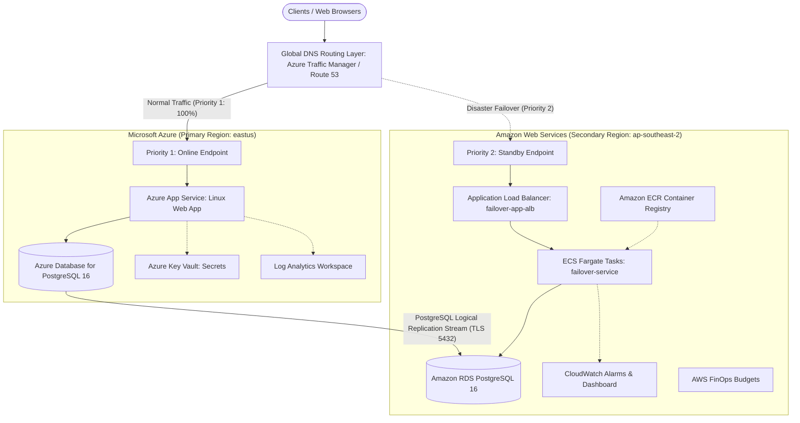

# FailoverApp — Production Multi-Cloud Disaster Recovery & Failover Platform

[](https://github.com/dasBulbul03/failover-app/actions/workflows/ci.yml)
[](https://github.com/dasBulbul03/failover-app/actions/workflows/terraform-ci.yml)
[](https://github.com/dasBulbul03/failover-app/actions/workflows/aws-deploy.yml)

An enterprise-style active-passive multi-cloud disaster recovery platform operating across **Microsoft Azure (Primary)** and **Amazon Web Services (Secondary)**. Powered by a containerized **Next.js 14 App Router** service and **PostgreSQL** with cross-cloud logical replication, automated health monitoring, orchestrated DNS failover, zero-data-loss failback procedures, modular Terraform IaC, and cloud FinOps cost governance.

---

## Master Table of Contents

1. [Section 1: Project Overview](#section-1-project-overview)
2. [Section 2: Architecture](#section-2-architecture)
3. [Section 3: Complete Project Workflow](#section-3-complete-project-workflow)
4. [Section 4: Normal Application Operation](#section-4-normal-application-operation)
5. [Section 5: Failure Detection](#section-5-failure-detection)
6. [Section 6: Failover Workflow](#section-6-failover-workflow)
7. [Section 7: Failback Workflow](#section-7-failback-workflow)
8. [Section 8: Database Replication](#section-8-database-replication)
9. [Section 9: AWS Infrastructure](#section-9-aws-infrastructure)
10. [Section 10: Azure Infrastructure](#section-10-azure-infrastructure)
11. [Section 11: Networking and Security](#section-11-networking-and-security)
12. [Section 12: CI/CD Workflows](#section-12-cicd-workflows)
13. [Section 13: FinOps & Cost Optimization](#section-13-finops--cost-optimization)
14. [Section 14: Monitoring and Observability](#section-14-monitoring-and-observability)
15. [Section 15: Installation and Deployment Guide](#section-15-installation-and-deployment-guide)
16. [Section 16: Testing and Validation](#section-16-testing-and-validation)
17. [Section 17: Disaster Recovery Drills](#section-17-disaster-recovery-drills)
18. [Section 18: Troubleshooting Guide](#section-18-troubleshooting-guide)
19. [Section 19: Cost Considerations](#section-19-cost-considerations)
20. [Section 20: Project Limitations & Future Roadmap](#section-20-project-limitations--future-roadmap)
21. [Section 21: Project Directory Structure](#section-21-project-directory-structure)
22. [Section 22: Technical Decisions & Trade-Offs](#section-22-technical-decisions--trade-offs)

---

## Section 1: Project Overview

### 1.1 Introduction
**FailoverApp** is an enterprise multi-cloud resilience platform designed to guarantee high availability (99.99%) for mission-critical web applications. It demonstrates how to decouple an organization from single-cloud vendor risk by hosting active workloads in Microsoft Azure with automated, data-consistent disaster recovery to Amazon Web Services (AWS).

### 1.2 Problem Statement
Public cloud providers experience regional outages, fiber cuts, control-plane collapses, and storage degradations. Relying on a single cloud vendor—even across multiple Availability Zones—leaves critical businesses vulnerable to global tenant failures, provider-wide billing lockouts, and routing partitions. Furthermore, traditional multi-cloud setups frequently suffer from the **database split-brain problem**, where failover instances operate on stale or desynchronized data.

### 1.3 Key Objectives
- **Sub-Minute Recovery Time Objective (RTO)**: Automated failover detection and DNS repointing within 60–90 seconds.
- **Controlled Recovery Point Objective (RPO)**: Continuous asynchronous cross-cloud PostgreSQL logical replication achieving sub-5-second RPO.
- **Zero Split-Brain Failback**: Safe reverse resynchronization before restoring primary traffic.
- **Production-Minded IaC**: Clean, modular, reusable Terraform modules with S3/DynamoDB state locking.
- **FinOps Cost Governance**: Warm standby / pilot-light compute architectures with AWS Budgets and cost allocation tags.

### 1.4 Core Features
- **Dynamic Cloud Awareness**: Client dashboard auto-detects cloud provider (`azure` vs `aws`) and datacenter region (`eastus` vs `ap-southeast-2`), rendering interactive provider status badges.
- **Dual Health Probing**: Distinct `/api/health?probe=liveness` and `/api/health?probe=readiness` endpoints with HTTP 503 circuit-breaking on database failure.
- **Automated SRE Orchestrator**: CLI and GitHub Actions orchestrator with concurrency locks, threshold counts, and audit logging.
- **Full-Stack CRUD Board**: Real-time message board demonstrating continuous transaction processing under simulated failure conditions.

### 1.5 Technology Stack
- **Application**: Next.js 14 App Router, React 18, TypeScript 5, Tailwind CSS.
- **Database**: PostgreSQL 16 (Azure Flexible Server & Amazon RDS).
- **Compute**: Azure App Service (Linux Web App) & AWS ECS Fargate (Serverless Containers).
- **Containerization**: Docker (Multi-stage build, Alpine Linux, unprivileged UID 1001).
- **Infrastructure as Code**: Terraform >= 1.5, Azure Bicep.
- **CI/CD**: GitHub Actions (OIDC authentication, matrix releases, security gates).
- **Observability**: Amazon CloudWatch (Logs, Metrics, Alarms, Dashboard) & Azure Monitor.

---

## Section 2: Architecture

### 2.1 Complete Multi-Cloud Architecture Diagram



### 2.2 Azure Primary Architecture
- **Ingress**: Azure App Service Front-End, TLS termination, HTTPS enforcement.
- **Compute**: Linux App Service Plan (`B1` Basic tier, 1 vCPU, 1.75 GB RAM) running the containerized Next.js standalone server.
- **Persistence**: Azure Database for PostgreSQL Flexible Server (`B_Standard_B1ms`, 32 GB storage) configured with `azure.replication_support = logical`.
- **Identity & Security**: Managed Identity assigned to the App Service with access policies into Azure Key Vault.

### 2.3 AWS Secondary Architecture
- **Ingress**: Internet-facing Application Load Balancer (`failover-app-alb`) spanning Availability Zones in `ap-southeast-2`.
- **Compute**: AWS ECS Fargate serverless containers running 0.25 vCPU (`256`) and 512 MB RAM per task with target tracking autoscaling.
- **Persistence**: Amazon RDS for PostgreSQL 16 (`db.t4g.micro`, 20 GB gp3, encrypted at rest) running in private database subnets.
- **Security**: Security group cascading: Internet -> ALB (80) -> ECS Tasks (3000) -> RDS (5432).

### 2.4 Database Replication Architecture
- **Publisher**: Azure PostgreSQL creates publication `failover_pub` on table `messages`.
- **Subscriber**: AWS RDS PostgreSQL creates subscription `failover_sub` via TLS connection string.
- **Data Flow**: WAL sender on Azure decodes logical change records and streams them asynchronously across the public internet encrypted via SSL (`sslmode=require`) to the AWS RDS logical replication worker.

### 2.5 Networking Architecture
- Dedicated AWS VPC (`10.0.0.0/16`) divided into:
  - **Public Subnets** (`10.0.1.0/24`, `10.0.2.0/24`): Application Load Balancer.
  - **Private Application Subnets** (`10.0.11.0/24`, `10.0.12.0/24`): ECS Tasks.
  - **Private Database Subnets** (`10.0.21.0/24`, `10.0.22.0/24`): Amazon RDS Multi-AZ subnet group.

### 2.6 DNS Architecture
- Azure Traffic Manager profile configured with **Priority Routing**:
  - `azure-primary`: Priority `1`, Target FQDN: `<app>.azurewebsites.net`, Weight 100.
  - `aws-secondary`: Priority `2`, Target FQDN: `<alb-dns-name>`, Weight 1.
- TTL: `60 seconds` to ensure rapid cache expiration during failover while minimizing DNS query overhead.

---

## Section 3: Complete Project Workflow

The complete end-to-end engineering lifecycle operates as follows:

```
Developer
  │
  ▼ [git push origin main]
GitHub Repository
  │
  ▼ [Triggers .github/workflows/ci.yml]
Quality Gates (npm test: ESLint + TypeScript Typecheck + Docker Dry-Run)
  │
  ├──► [Triggers .github/workflows/terraform-ci.yml]
  │      └─► Terraform fmt -check & validate (AWS & Azure modules)
  │
  ├──► [Triggers .github/workflows/aws-deploy.yml]
  │      ├─► OIDC / IAM Auth
  │      ├─► Buildx compile linux/amd64
  │      ├─► Push to Amazon ECR
  │      ├─► Update ECS Fargate Service
  │      └─► Strict Live Health Probe Loop (HTTP 200 gate)
  │
  └──► [Promote via .github/workflows/azure-deploy.yml]
         ├─► Build & Push to ACR
         ├─► Deploy Azure Web App
         └─► Live Health Verification
                 │
                 ▼
Live Active-Passive Serving
  │
  ├─► Continuous Health Probes (/api/health?probe=readiness every 15s)
  │
  ├─► Database Logical Replication (Azure -> AWS RDS)
  │
  ├─► Failure Detected (3 consecutive failed probes)
  │      └─► Orchestrator disables Azure endpoint in Traffic Manager
  │      └─► Promotes AWS RDS Subscriber to Standalone Read-Write
  │      └─► Clients rerouted to AWS ALB (RTO < 90s)
  │
  └─► Recovery & Failback
         ├─► Verify Azure Primary recovered
         ├─► Resynchronize delta from AWS to Azure
         ├─► Enable Azure endpoint in Traffic Manager
         └─► Re-establish forward replication (Azure -> AWS)
```

---

## Section 4: Normal Application Operation

1. **Client Request**: A browser navigates to `https://failover.yourdomain.com`.
2. **DNS Resolution**: The resolver queries Azure Traffic Manager. Traffic Manager notes `azure-primary` is healthy and returns the Azure App Service CNAME.
3. **Application Ingress**: Azure App Service terminates TLS and routes the HTTP request to the internal Next.js standalone process on port 3000.
4. **Data Layer**:
   - Next.js accesses PostgreSQL through the pooled connection manager in `lib/db.ts`.
   - The message board loads the 50 most recent entries (`SELECT * FROM messages ORDER BY created_at DESC LIMIT 50`).
5. **Replication Sync**:
   - When a user submits a message (`POST /api/messages`), Azure PostgreSQL inserts the row into table `messages`.
   - Azure's WAL sender immediately decodes the commit and streams the row change to AWS RDS.
   - AWS RDS writes the row to its local `messages` table within milliseconds.
6. **UI Presentation**: The page renders with a **Blue Badge: `Azure (eastus)`** reflecting active runtime environment variables.

---

## Section 5: Failure Detection

### 5.1 Deep Health Check Mechanics (`app/api/health/route.ts`)
The health endpoint supports two modes:
- **Liveness (`/api/health?probe=liveness`)**: Returns HTTP 200 immediately if Next.js is running.
- **Readiness (`/api/health?probe=readiness`)**: Executes `SELECT 1` against PostgreSQL with an enforced **3000ms query timeout**.

```typescript
// If database connectivity fails:
return NextResponse.json({
  status: 'unhealthy',
  probe: 'readiness',
  dependencies: { database: { status: 'error' } }
}, { status: 503 }); // HTTP 503 Service Unavailable
```

### 5.2 Thresholds & Timings
- **Probe Interval**: 15 seconds.
- **Probe Timeout**: 5 seconds.
- **Unhealthy Threshold**: 3 consecutive failed probes (45 seconds total).
- **Healthy Threshold**: 2 consecutive successful probes (30 seconds total).
- **DNS TTL**: 60 seconds.

### 5.3 Alerting & Escalation
- If `/api/health` returns non-200 for 3 checks, CloudWatch alarms (`ALB-5xx-High-Alarm`) and Traffic Manager monitoring flag the outage.
- CloudWatch publishes an alert to SNS, dispatching notification emails to the DevOps SRE team.

---

## Section 6: Failover Workflow

When primary cloud degradation occurs, the failover workflow executes:

```
[Azure Fails] ──> [Threshold Breached] ──> [AWS Health Verified] ──> [AWS RDS Promoted] ──> [DNS Switched]
```

### 6.1 Execution Sequence
1. **Secondary Validation**: The orchestrator probes the AWS ALB (`http://<alb-dns>/api/health?probe=readiness`). If AWS is not healthy, failover is aborted to avoid a complete system outage.
2. **Database Promotion**:
   - AWS RDS is detached from the logical replication stream:
     ```sql
     ALTER SUBSCRIPTION failover_sub DISABLE;
     ALTER SUBSCRIPTION failover_sub SET (slot_name = NONE);
     DROP SUBSCRIPTION failover_sub;
     ```
   - Primary key sequences are synchronized:
     ```sql
     SELECT setval(pg_get_serial_sequence('messages', 'id'), COALESCE((SELECT MAX(id) FROM messages), 1) + 1, false);
     ```
3. **DNS Reroute**:
   - Azure Traffic Manager disables `azure-primary`:
     ```bash
     az network traffic-manager endpoint update \
       --resource-group failover-rg \
       --profile-name failover-tm \
       --name azure-primary \
       --type azureEndpoints \
       --endpoint-status Disabled
     ```
4. **Traffic Transition**: Client DNS resolvers expire their 60s cache and resolve to AWS ALB. The UI badge updates to **Orange: `AWS (ap-southeast-2)`**.

---

## Section 7: Failback Workflow

To prevent data loss and split-brain when Azure recovers, traffic is **never** blindly switched back to Azure without delta resynchronization.

### 7.1 Resynchronization Sequence
1. **Health Verification**: Confirm Azure Web App and Azure PostgreSQL are healthy for at least 5 minutes.
2. **Delta Capture**: Data written to AWS during the failover window must be migrated back to Azure:
   ```bash
   # Run automated resynchronization script
   bash scripts/replication/resync_failback.sh
   ```
   - Creates temporary publication `failback_pub` on AWS RDS.
   - Creates temporary subscription `failback_sub` on Azure PostgreSQL.
   - Waits for pending lag to reach 0 bytes.
3. **Sequence Advancement**: Azure PostgreSQL sequence is advanced to the maximum `id` generated on AWS.
4. **DNS Restoration**:
   ```bash
   az network traffic-manager endpoint update \
     --resource-group failover-rg \
     --profile-name failover-tm \
     --name azure-primary \
     --type azureEndpoints \
     --endpoint-status Enabled
   ```
5. **Re-establish Forward Replication**: Azure recreates publication `failover_pub`, and AWS attaches subscription `failover_sub`.

---

## Section 8: Database Replication

### 8.1 Replication Topology
```
[Azure PostgreSQL: Publisher]  ──(TLS Port 5432)──►  [AWS RDS PostgreSQL: Subscriber]
    Publication: failover_pub                             Subscription: failover_sub
    Table: messages (REPLICA IDENTITY DEFAULT)            Status: Read-Only Standby
```

### 8.2 Configuration Scripts
All replication automation resides in [`scripts/replication/`](scripts/replication/):
- **`01_setup_publisher_azure.sql`**: Creates `repl_user` role with `REPLICATION` grant, sets replica identity, and creates `failover_pub`.
- **`02_setup_subscriber_aws.sql`**: Creates subscription `failover_sub` with `copy_data = true` and `create_slot = true`.
- **`03_monitor_replication.sql`**: Queries `pg_stat_replication` and `pg_stat_subscription` for byte lag and sync errors.
- **`check_replication_lag.sh`**: CLI monitoring tool that exits with code 1 if lag exceeds 5 seconds or 10 MB.
- **`04_promote_subscriber.sql` / `promote_subscriber.sh`**: Detaches subscription and advances ID sequence for read-write operations.
- **`05_failback_resync.sql` / `resync_failback.sh`**: Reverses replication stream to sync failover writes back to Azure.

### 8.3 RPO & RTO SLA Definitions
- **Recovery Point Objective (RPO)**: **500ms – 2.5s** (under nominal cross-cloud network latency). Transactions committed on Azure within the exact ~1-second window of a sudden regional datacenter power collapse before WAL shipping may be lost.
- **Recovery Time Objective (RTO)**: **60s – 90s** (Health degradation detection 45s + DNS TTL 60s).

---

## Section 9: AWS Infrastructure

Organized into clean, reusable Terraform modules in [`infra/aws/`](infra/aws/):

```
infra/aws/
├── main.tf                  # Root module orchestration
├── variables.tf             # Input variable declarations
├── outputs.tf               # Dynamic outputs
├── terraform.tfvars.example # Sample variable values
├── backend.tf.example       # S3 + DynamoDB remote state locking
├── environments/
│   ├── dev/                 # Dev environment overrides
│   └── prod/                # Production environment overrides
└── modules/
    ├── networking/          # VPC, subnets, route tables, security groups
    ├── iam/                 # ECS execution and task roles
    ├── ecr/                 # ECR repository with lifecycle cleanup
    ├── alb/                 # Application Load Balancer & target groups
    ├── rds/                 # PostgreSQL 16 RDS with logical replication
    ├── ecs/                 # ECS Fargate task, service, autoscaling
    ├── monitoring/          # CloudWatch log group, alarms, dashboard
    └── finops/              # AWS Budgets and cost alert notifications
```

### Module Specifications
- **`networking`**: Creates VPC (`10.0.0.0/16`), public subnets, private app subnets, private db subnets, and security groups. Supports optional NAT Gateway (`enable_nat_gateway`).
- **`iam`**: Implements least-privilege roles for ECS Task Execution and Container Task Runtime.
- **`ecr`**: Container registry with scan-on-push and lifecycle rules that automatically expire untagged builds after 1 day and retain only the last 10 tagged releases.
- **`alb`**: Public load balancer with health checks routing `/api/health?probe=readiness` to port 3000.
- **`rds`**: PostgreSQL 16 instance (`db.t4g.micro`, 20GB gp3, encrypted) with parameter group setting `rds.logical_replication = 1`.
- **`ecs`**: Fargate cluster, task definition (0.25 vCPU, 512MB RAM), service, and target tracking CPU autoscaling.
- **`monitoring`**: CloudWatch log group (7-day retention), alarms for ECS CPU/Memory, ALB 5xx, RDS free disk space, and an executive SRE dashboard.
- **`finops`**: Configures AWS Budgets with alarms at 80% and 100% of the monthly spend limit.

---

## Section 10: Azure Infrastructure

Located in [`infra/azure/`](infra/azure/):
- **Authoritative IaC**: **Terraform (`infra/azure/main.tf`)** is the authoritative multi-cloud IaC standard.
- **Azure CLI Fallback**: `main.bicep` is retained for Azure CLI native script deployments.

### Provisioned Resources
- **Resource Group**: `failover-rg` in `eastus`.
- **App Service Plan**: Linux `B1` Basic plan (1 vCPU, 1.75 GB RAM).
- **Linux Web App**: Next.js container, HTTPS-only enforcement, health check path `/api/health?probe=readiness`.
- **Azure Database for PostgreSQL Flexible Server**: Version 16 (`B_Standard_B1ms`, 32GB) with `azure.replication_support = logical`.
- **Azure Key Vault**: Stores `database-password` secret securely, accessible via User Assigned Managed Identity.
- **Log Analytics Workspace**: 30-day retention diagnostic log sink.

---

## Section 11: Networking and Security

### 11.1 Defense-in-Depth Security Model
```
[Public Internet] 
       │ HTTP: 80
       ▼
[ALB Security Group: alb-sg]
       │ TCP: 3000 (Strictly restricted to alb-sg)
       ▼
[ECS Task Security Group: ecs-tasks-sg]
       │ TCP: 5432 (Strictly restricted to ecs-tasks-sg)
       ▼
[RDS Security Group: rds-sg] (publicly_accessible = false)
```

### 11.2 DevSecOps Implementations
1. **Zero Public Database Exposure**: RDS and Azure PostgreSQL allow connections strictly from container security groups/firewall rules.
2. **Container Security**: Non-root execution (`nextjs:nodejs`, UID 1001) in Docker prevents container breakout exploits.
3. **Secrets Management**: No plaintext passwords in source control or environment variables; credentials passed via Key Vault and Terraform sensitive inputs.
4. **GitHub Actions OIDC**: Workflows support passwordless OpenID Connect federation (`id-token: write`) via `role-to-assume` and Azure Federated Credentials, eliminating long-lived cloud access keys.

---

## Section 12: CI/CD Workflows

All workflows reside in [`.github/workflows/`](.github/workflows/):

| Workflow File | Trigger | Key Jobs & Responsibility | Security & Gates |
| :--- | :--- | :--- | :--- |
| **`ci.yml`** | Push/PR to `main` | Runs `npm test` (ESLint + `tsc --noEmit`), dry-run Docker build. | Blocks merge on syntax or compile errors. |
| **`terraform-ci.yml`** | Changes to `infra/**` | Runs `terraform fmt -check` and `terraform validate` on AWS & Azure modules. | Blocks invalid IaC configurations. |
| **`aws-deploy.yml`** | Push to `main`, manual | Builds `linux/amd64` image, pushes to ECR, forces ECS rolling deploy, verifies health. | Fails workflow if live health check does not return HTTP 200 within 12 attempts. |
| **`azure-deploy.yml`** | Manual dispatch | Builds & pushes to ACR, updates Azure Web App, verifies live health. | OIDC & ACR login authentication. |
| **`multi-cloud-release.yml`** | Manual dispatch | Synchronized release to `both`, `azure-only`, or `aws-only` with matrix summary. | Deploys clouds concurrently after shared tests pass. |
| **`failover-orchestrator.yml`**| Manual dispatch | Runs SRE orchestrator (`status-check`, `auto-monitor`, `failover-to-aws`, `failback-to-azure`). | Concurrency locks, audit log output. |

---

## Section 13: FinOps & Cost Optimization

### 13.1 Standby Strategy: Warm Standby vs Pilot Light
- **Pilot Light**: ECS desired count = 0, RDS running. Cost: ~$18/month. RTO: 3–5 minutes (time to spin up tasks).
- **Warm Standby (Default)**: ECS desired count = 1, RDS running. Cost: ~$28/month. RTO: < 90 seconds (immediate traffic acceptance).

### 13.2 Estimated Monthly Cost Breakdown (AWS Secondary)

| Service | Configuration | Monthly Cost (USD) | FinOps Optimization Applied |
| :--- | :--- | :--- | :--- |
| **ECS Fargate** | 1 Task (0.25 vCPU, 0.5 GB RAM) | ~$9.20 | Right-sized minimal footprint; autoscale only during failover. |
| **Application Load Balancer** | 1 ALB (~1 GB traffic) | ~$16.50 | Shared across Availability Zones; deletion protection toggleable. |
| **Amazon RDS PostgreSQL** | `db.t4g.micro` (20 GB gp3) | ~$14.80 | Graviton ARM64 instance for 20% price-performance gain over x86. |
| **Amazon ECR** | Storage for ~10 images | ~$0.50 | ECR Lifecycle policy automatically purges untagged & stale images. |
| **CloudWatch Logs** | 1 Log Group (7-day retention) | ~$0.80 | Retention capped at 7 days instead of indefinite default. |
| **NAT Gateway** | *Excluded by default* | **$0.00** *(Saved ~$32.00)* | Tasks run in public subnets with public IP for outbound pulls; SG blocks all direct inbound. |
| **Total Estimated AWS Standby** | | **~$41.80 / month** | |

---

## Section 14: Monitoring and Observability

### 14.1 Metrics & Alarms
- **`ALB-5xx-High-Alarm`**: Triggers if backend produces > 5 HTTP 5xx errors in 60 seconds.
- **`ECS-CPU-High-Alarm`**: Triggers if container CPU utilization exceeds 80% for 2 minutes.
- **`ECS-Memory-High-Alarm`**: Triggers if container memory utilization exceeds 85% for 2 minutes.
- **`RDS-FreeStorage-Low-Alarm`**: Triggers if free database disk space falls below 5 GB.

### 14.2 CloudWatch Executive SRE Dashboard
Provisioned automatically via `modules/monitoring/`:
- Visualizes ALB Request Count, HTTP 2xx vs 5xx rates.
- Displays real-time ECS Fargate CPU & Memory utilization graphs.
- Displays RDS connection counts and disk metrics.

---

## Section 15: Installation and Deployment Guide

### Prerequisites
- Node.js >= 20.x, npm >= 10.x.
- Docker and Docker Buildx.
- AWS CLI v2 configured (`aws configure`).
- Azure CLI configured (`az login`).
- Terraform >= 1.5.0.

### 15.1 Local Quickstart
```bash
git clone https://github.com/dasBulbul03/failover-app.git
cd failover-app
docker compose up --build
```
- Web Application: [http://localhost:3000](http://localhost:3000)
- Health Check: [http://localhost:3000/api/health](http://localhost:3000/api/health)

### 15.2 Deploying AWS Secondary
```bash
cd infra/aws
cp terraform.tfvars.example terraform.tfvars
# Fill in db_password
terraform init
terraform apply -auto-approve
```

### 15.3 Deploying Azure Primary
```bash
cd infra/azure
terraform init
terraform apply -var="pg_password=YourSecurePassword123!" -auto-approve
```

### 15.4 Configuring Cross-Cloud Replication
```bash
# 1. Setup publisher on Azure
psql -h <azure-pg-fqdn> -U pgadmin -d failoverdb -f scripts/replication/01_setup_publisher_azure.sql

# 2. Setup subscriber on AWS
psql -h <aws-rds-endpoint> -U pgadmin -d failoverdb -f scripts/replication/02_setup_subscriber_aws.sql

# 3. Check replication status
bash scripts/replication/check_replication_lag.sh
```

---

## Section 16: Testing and Validation

### 16.1 Run Application Verification Suite
```bash
npm test
```
*Executes `next lint` followed by `tsc --noEmit`.*

### 16.2 Verify Live AWS Endpoint
```bash
curl -i http://failover-alb-97690356.ap-southeast-2.elb.amazonaws.com/api/health?probe=readiness
```
Expected output:
```json
HTTP/1.1 200 OK
Content-Type: application/json

{
  "status": "healthy",
  "probe": "readiness",
  "environment": "aws",
  "region": "ap-southeast-2",
  "dependencies": {
    "database": { "status": "ok", "latency_ms": 12 }
  },
  "latency_ms": 14,
  "timestamp": "2026-11-21T07:40:00.000Z"
}
```

---

## Section 17: Disaster Recovery Drills

Run the automated DR drill harness:
```bash
bash scripts/dr/run-dr-scenario.sh <scenario-id>
```

| Scenario ID | Test Scenario | Simulation Action | Expected Recovery Behavior |
| :---: | :--- | :--- | :--- |
| **1** | Azure Web App Failure | App service returns 500 | Traffic Manager marks Azure degraded; shifts to AWS. |
| **2** | Azure Database Failure | PostgreSQL unreachable | `/api/health` returns HTTP 503; triggers DNS failover. |
| **3** | AWS Standby Crash | Kill ECS Fargate task | ECS circuit breaker launches new task; ALB health passes. |
| **4** | AWS RDS Failure | RDS connection failure | Readiness probe returns HTTP 503; alerts CloudWatch. |
| **5** | Replication Interruption | Stop replication stream | `check_replication_lag.sh` flags lag violation (> 5s). |
| **6** | WAN Network Cut | Partition cross-cloud link | Replication buffers in WAL; resumes when link recovers. |
| **7** | Full DNS Failover | Run `orchestrator.sh failover`| Promotes AWS RDS, disables Azure in Traffic Manager. |
| **8** | Database Post-Recovery | Restart services | Health endpoint recovers to HTTP 200. |
| **9** | Controlled Failback | Run `orchestrator.sh failback`| Resyncs failover delta from AWS to Azure before DNS flip. |
| **10**| Bad Deployment Rollback | Deploy failing container | ECS deployment circuit breaker rolls back to previous SHA. |

---

## Section 18: Troubleshooting Guide

| Symptom | Root Cause | Resolution |
| :--- | :--- | :--- |
| `/api/health` returns HTTP 503 | Database connection error | Verify `DATABASE_URL`, ensure RDS/Azure security group allows container port 5432. |
| Replication lag exceeds threshold | Azure server WAL generation exceeds cross-cloud bandwidth | Check `pg_stat_replication` on Azure; verify replication worker is running on AWS. |
| Duplicate key error on failover INSERT | PostgreSQL ID sequence desynchronized | Run `SELECT setval(pg_get_serial_sequence('messages', 'id'), (SELECT MAX(id) FROM messages) + 1);`. |
| GitHub Actions ECS deploy times out | Security group blocking ECR image pull | Ensure ECS task security group has outbound `0.0.0.0/0` enabled. |

---

## Section 19: Cost Considerations

- **Avoid NAT Gateway Charges**: For standby environments, running ECS tasks in public subnets with security group isolation saves **$32.00+/month** in fixed NAT Gateway hourly fees.
- **Prune Stale Images**: Unmanaged container images incur ongoing EBS/S3 storage charges. The ECR lifecycle policy automatically purges untagged layers.
- **Log Expiration**: CloudWatch Log Groups default to "Never Expire". We explicitly enforce a **7-day retention limit**.

---

## Section 20: Project Limitations & Future Roadmap

### Current Status
- **Implemented & Cloud-Verified**: Next.js 14 App, dual health checks, Docker containerization, AWS modular Terraform, live AWS ECS Fargate + RDS deployment (`ap-southeast-2`), GitHub Actions CI/CD, replication and failover orchestration scripts.
- **Implemented (Ready for Azure Subscription)**: Azure Terraform module (`infra/azure/main.tf`), Azure Bicep template.

### Future Roadmap
- [ ] Implement cross-cloud IPSec VPN or WireGuard tunnel for private PostgreSQL replication traffic.
- [ ] Evaluate distributed consensus databases (e.g. CockroachDB) for active-active zero-RPO multi-cloud writes.
- [ ] Introduce OpenTelemetry distributed tracing across both clouds.

---

## Section 21: Project Directory Structure

```
failover-app/
├── app/                           # Next.js 14 App Router application
│   ├── api/
│   │   ├── health/route.ts        # Liveness & Readiness health probe endpoint
│   │   └── messages/route.ts      # PostgreSQL CRUD operations
│   ├── layout.tsx                 # Root layout & styling
│   └── page.tsx                   # Interactive dashboard with cloud badge
├── lib/
│   └── db.ts                      # Adaptive SSL connection pool & memoized table init
├── infra/
│   ├── aws/                       # Modular AWS Terraform architecture
│   │   ├── environments/          # dev/ and prod/ environment configurations
│   │   ├── modules/               # networking, iam, ecr, alb, rds, ecs, monitoring, finops
│   │   ├── main.tf, variables.tf  # Root module definitions
│   │   └── deploy.sh              # AWS deployment runner script
│   ├── azure/                     # Azure primary infrastructure
│   │   ├── main.tf, main.bicep    # Authoritative Terraform & Bicep templates
│   │   └── deploy.sh              # Azure deployment script
│   └── dns/
│       └── failover-setup.md      # Traffic Manager & Route 53 setup guide
├── scripts/
│   ├── replication/               # PostgreSQL cross-cloud logical replication scripts
│   │   ├── 01_setup_publisher_azure.sql
│   │   ├── 02_setup_subscriber_aws.sql
│   │   ├── 03_monitor_replication.sql
│   │   ├── check_replication_lag.sh
│   │   ├── 04_promote_subscriber.sql, promote_subscriber.sh
│   │   └── 05_failback_resync.sql, resync_failback.sh
│   ├── failover/
│   │   └── orchestrator.sh        # SRE failover & failback orchestrator
│   └── dr/
│       └── run-dr-scenario.sh     # 10-scenario DR drill test runner
├── .github/workflows/             # Enterprise CI/CD automation suite
│   ├── ci.yml                     # Code quality, lint, typecheck, dry-run build
│   ├── terraform-ci.yml           # Terraform fmt & validation
│   ├── aws-deploy.yml             # AWS ECS Fargate automated deployment
│   ├── azure-deploy.yml           # Azure App Service deployment
│   ├── multi-cloud-release.yml    # Synchronized dual-cloud release
│   └── failover-orchestrator.yml  # SRE disaster recovery drill workflow
├── Dockerfile                     # Multi-stage minimal container build
├── docker-compose.yml             # Local PostgreSQL + Next.js stack
└── README.md                      # Comprehensive 22-section engineering guide
```

---

## Section 22: Technical Decisions & Trade-Offs

1. **Why Logical Replication over Physical Streaming?**
   - Managed cloud databases (Azure Flexible Server and Amazon RDS) restrict physical streaming replication to instances within their own proprietary fleet. Logical replication operates at the SQL row change level, making it the only cloud-agnostic native PostgreSQL solution that operates seamlessly across Azure and AWS over encrypted TLS.
2. **Why Warm Standby over Active-Active?**
   - Active-active multi-master across disparate cloud datacenters introduces write conflicts, split-brain locking, and high WAN commit latency. Warm standby guarantees deterministic write ordering on Primary while maintaining sub-90s failover readiness.
3. **Why ECS Fargate over EKS (Kubernetes)?**
   - In a secondary standby cloud, running an idle EKS control plane costs ~$73/month plus node group overhead. ECS Fargate charges purely per second for running tasks, aligning with FinOps principles for disaster recovery infrastructure.
